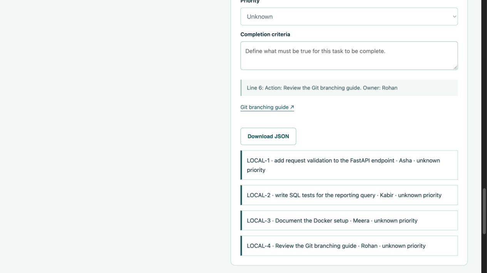
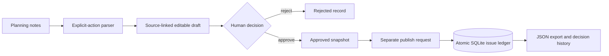

# Sprint Ledger

**Turn explicit commitments into reviewed work—with the source attached.**

Sprint Ledger is a small Python planning application: paste notes, inspect the
actions it recognizes, edit the fields, approve or reject the draft, then create
local issues exactly once.

[Source](https://github.com/dgexplores/sprint-ledger) ·
[Checks](https://github.com/dgexplores/sprint-ledger/actions/workflows/ci.yml) ·
[Reference analysis](docs/reference-analysis.md)



## The 60-second brief

Planning notes mix decisions, ideas and commitments. Automatically turning all
of them into tickets creates work nobody agreed to do. This application uses a
narrow, inspectable extraction rule and preserves an explicit review boundary.
Every task shows the original source line, and missing details remain unknown
until a person supplies them.

**Current mode is an explicit-action parser, not an LLM.** It creates issues in
its own SQLite ledger, not Jira. Documentation links use a small keyword
catalog, not live search. These limits are visible in the application.

### Try the complete workflow

1. Start the application and click **Load example**.
2. Click **Find commitments**. Four tasks appear with exact source quotes.
3. Check titles and owners, select priorities, and write completion criteria.
4. Click **Approve reviewed tasks**. No issues have been created yet.
5. Click **Create local issues**. The issue ledger and decision history update.
6. Download the JSON record. Repeating the publish request cannot duplicate
   issues, even when requests arrive concurrently.

A live URL will be added only after the deployed UI and API have been verified.
[render.yaml](render.yaml) provides a free-tier deployment configuration.

## Run locally

Python 3.12 is the tested runtime. No provider keys or external accounts needed.

```bash
python3 -m venv .venv
source .venv/bin/activate
pip install -r requirements-dev.txt
uvicorn app:app --host 127.0.0.1 --port 8000
```

Open **http://127.0.0.1:8000** for the workspace,
**http://127.0.0.1:8000/docs** for the API, and
**http://127.0.0.1:8000/healthz** for the disclosed runtime mode.

Use fictional notes in the public demo. The default database path is
`/tmp/sprint-ledger.sqlite`; set `SPRINT_DB` to an application-owned persistent
path for local persistence. Records survive process restart while that file
and the browser-session cookie remain available. Free-hosting storage can be
reset by the host and is not a durable production database.

### Supported input

```text
Asha: I will add request validation to the FastAPI endpoint. Due: 2026-11-05
Action: Write SQL regression tests | Owner: Kabir | Priority: high
TODO: Document rollback steps
- [ ] Review the Docker build guide. Owner: Meera
```

Recognizes `Name: I will …`, `Name: I'll …`, `Action: …`, `TODO: …`, and
unchecked list items. `Owner:`, `Due:` and `Priority:` supply explicit metadata.
Dates use `YYYY-MM-DD`. Invalid source dates remain blank for review; invalid
reviewed dates are rejected. High/medium/low priorities are recognized; other
values become unknown.

General conversation such as “we should discuss the roadmap” creates no task.
An input with no recognized actions returns an explanatory error rather than
inventing a meeting-summary task. Maximum 12 tasks, 20,000 transcript characters,
50 KB request body, and 20 plans per browser session.

## Architecture



### Decisions an interviewer can inspect

**Why retain the source after editing?** An edited title is a reviewer decision;
its original quote remains separate evidence. The server ignores attempts to
replace a task's source quote through the review payload.

**Why approval and publishing are separate?** A person can approve the proposed
scope without immediately creating issues. Rejected and unapproved plans cannot
be published. A stale review is refused by version/state checks.

**How do retries avoid duplicate issues?** Publishing runs in a SQLite
`BEGIN IMMEDIATE` transaction. Issues have a unique `(plan, task_id)` constraint.
The plan becomes published and its event is recorded within that transaction.
Retries with the same or a different idempotency key return the existing issue
set. Keys are scoped to a plan, not globally across the application.

**How are demo records isolated?** A random HTTP-only SameSite browser cookie
identifies a demo session. The server hashes it and checks ownership on reads,
review and publish. Set `COOKIE_SECURE=true` behind HTTPS, as the Render
Blueprint does. A session is not an authenticated person or role system.

**Why no autonomous Jira/email calls?** This implementation demonstrates the
review and execution boundary without granting a public demo external write
credentials. External delivery would need a separate authenticated integration,
reviewable target selection and reconciliation after uncertain delivery.

**Why a parser?** A reproducible baseline is useful for testing workflow safety.
Its limited syntax is an explicit product constraint. It does not demonstrate
general semantic understanding or claim LLM/agent capability. A future model
extractor must preserve the same schema, evidence and approval boundary and be
evaluated separately.

## Verification

```bash
python -m pytest -q
node --check static/app.js
```

On 22 October 2026, **10 tests passed** in the local development runtime. They
exercise evidence preservation, metadata parsing, valid calendar dates, unknown
fields, invalid review atomicity, stale reviews, rejection, request limits,
cross-origin refusal, cross-session access, restart persistence, and a four-way
concurrent publish race. The race produces one set of four issues and one
publication event. These are workflow checks, not a model-quality benchmark.

CI installs pinned direct dependencies, reruns tests and builds the Docker
image. CI/deployment status should be checked at the linked workflow; local
success is not a claim that a remote build has passed.

## API workflow

| Method and path | Purpose |
| --- | --- |
| `GET /api/sample` | Fictional example notes |
| `POST /api/plans` | Extract an editable draft |
| `GET /api/plans/{id}` | Read your session's plan, issues and events |
| `POST /api/plans/{id}/review` | Explicit approve/reject with version and edited tasks |
| `POST /api/plans/{id}/publish` | Idempotent local issue creation after approval |
| `GET /healthz` | Runtime mode and external-write status |

Use the same cookie jar across API requests; otherwise the next request belongs
to a different browser session. Draft exports include current browser edits and
are labelled unapproved/unsaved. Approved exports reflect the saved snapshot.

## Deploy

```bash
docker build -t sprint-ledger .
docker run --rm -p 8000:8000 sprint-ledger
```

The Docker process runs as an unprivileged user and accepts `$PORT`. The Render
Blueprint starts a single worker with `/healthz` as its health check and secure
cookies enabled. Free services can sleep, so a cold start may take time.

The single-process lock protects the shared SQLite connection; transaction and
unique constraints protect publishing in the database. This configuration is
not a horizontally scaled service. Production use needs authenticated users,
roles, retention controls, backups, a durable database and operational limits.

## Repository map

| Path | Responsibility |
| --- | --- |
| `app.py` | Parser, validation, session boundary, state transitions and SQL ledger |
| `static/` | Notes workspace, editable review cards, source evidence and JSON export |
| `tests/test_workflow.py` | Happy paths, failures, persistence and concurrent replay |
| `docs/reference-analysis.md` | Observed SprintForge configuration and design differences |
| `render.yaml`, `Dockerfile` | Reproducible deployment configuration |

## Origin, contribution and limitations

This is an original implementation for Deepak Gangwar's portfolio, developed
with AI assistance. It was inspired by SprintForge, by Shrushti Shah and Bhushan
Gawale, whose managed solution connects Copilot Studio to Microsoft Learn and
Jira. The [source study](docs/reference-analysis.md) records the inspected commit
and archive members. No upstream code, prompts, tenant configuration or media
were copied, and the original team's award and claimed time savings are not
claimed here.

The new contribution is source-linked deterministic extraction, editable
unknown fields, explicit review, local SQL state, version checks, duplicate-safe
publishing, session isolation and a browser workflow. There is no LLM inference,
MCP connection, Jira delivery, live documentation retrieval, email ingestion,
PDF parsing, transcript recording, hierarchy inference or measured productivity
saving in this version. Original source configuration was inspected but not run.

**Relevant skills:** Python, structured text processing, REST APIs, SQL,
validation, transactions, concurrency, testing, debugging, Git, CI, SDLC,
automation and technical documentation. This project should be paired with an
actual ML/LLM project when targeting an AI role.

MIT licensed; see [LICENSE](LICENSE).

## Browser verification

The local browser workflow was verified end to end: load example, extract four commitments, edit a completion criterion, approve, and create four local issues. The screenshot records the actual resulting interface; no Jira or email was sent. Hosted verification follows deployment.
