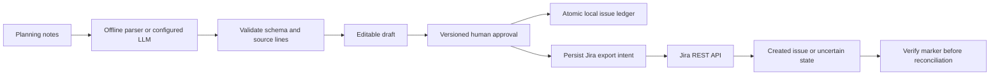

# Sprint Ledger

Turn planning notes into source-linked, editable tasks; approve a snapshot before creating local or Jira issues.

**Rebuild status:** original Python application, developed with AI assistance. This upgrade includes an offline hosted workflow and optional configured integrations. Provider and Jira boundaries were tested with mock HTTP transports; no live LLM quality evaluation or Jira tenant validation is claimed. Use the current source and release verification for this version.

## The problem and workflow

Planning notes mix ideas and commitments. A generated task can look convincing while assigning work nobody agreed to do. Sprint Ledger preserves the source line, leaves unsupported metadata blank, requires review, and separates that decision from publication.

1. Paste fictional notes and choose offline extraction or configured AI extraction.
2. Inspect each exact source line. Edit titles, owners, dates, priority and completion criteria.
3. Approve or reject the versioned draft. No issue is created by approval alone.
4. Create local issues, or explicitly confirm Jira export with an operator publish token.
5. Inspect the saved issues and decision history. Download the JSON record.

## What is implemented

| Capability | Behavior |
|---|---|
| Offline extraction | Recognizes explicit actions, commitments and action-list syntax; no external calls |
| Optional AI extraction | OpenAI-compatible chat API extracts proposals from unstructured notes |
| Evidence checks | Every proposal must cite a valid line and its entire exact source text |
| Unknown metadata | Owners, dates and priorities absent from that quote are blank/unknown; reviewed calendar dates are validated |
| Human review | Editable fields, preserved source evidence, version checks, approve/reject before publication |
| Local publishing | SQLite transaction and unique task constraint make replay duplicate-safe |
| Optional Jira Cloud adapter | Calls the real REST v3 issue endpoint; credentials, target project and issue type are server-controlled |
| External write boundary | Approval, exact plan version, explicit write confirmation, session ownership and operator token required |
| Uncertain delivery | Persisted intent before POST; failed/crashed requests block automatic retry instead of risking a duplicate |
| Reconciliation | An operator can link an existing issue only after checking its exact export marker through Jira |

Documentation references in offline mode come from a small local keyword catalog, not live Microsoft Learn retrieval. AI proposals currently have no automatically retrieved reference links. There is no MCP or email integration.

## Run locally

Python 3.12 is the tested runtime. The default workflow requires no external accounts.

```bash
uv venv --python 3.12 .venv
uv pip install --python .venv/bin/python -r requirements-dev.txt
.venv/bin/uvicorn app:app --host 127.0.0.1 --port 8000
```

Open `http://127.0.0.1:8000`, `/docs` for API contracts, and `/healthz` for configured capabilities. Set `SPRINT_DB` to an application-owned SQLite path for persistence; the default is `/tmp/sprint-ledger.sqlite`. Deploy with one worker. The process lock coordinates one SQLite connection, not a distributed worker fleet.

### Optional AI extraction

Set these environment variables on the server, then restart:

```text
SPRINT_LLM_API_KEY=<provider key>
SPRINT_LLM_MODEL=<model identifier>
SPRINT_LLM_ACCESS_TOKEN=<long random operator secret>
SPRINT_LLM_BASE_URL=https://api.openai.com/v1
```

`BASE_URL` is optional. HTTPS is required except localhost. In the UI enter the AI operator token and choose configured AI. The token is cleared after each extraction and is not stored. API callers must supply `X-AI-Token`; unauthorized requests are rejected before any provider call. Send `engine: "semantic"` to `POST /api/plans`. The default is `engine: "explicit"`.

Selecting AI sends notes to the configured provider and can incur charges. Keys stay on the server. Malformed responses, invalid quotes and dates fail before draft persistence. Valid source quotes do not prove a model's paraphrased task is semantically correct; a human must inspect it. No real-model accuracy, productivity saving or comparison with SprintForge has been measured.

### Optional Jira publishing

```text
SPRINT_JIRA_URL=https://your-company.atlassian.net
SPRINT_JIRA_EMAIL=<service account email>
SPRINT_JIRA_API_TOKEN=<Jira API token>
SPRINT_JIRA_PROJECT=<project key>
SPRINT_JIRA_ISSUE_TYPE=Task
SPRINT_JIRA_PUBLISH_TOKEN=<long random operator secret>
```

The issue type is optional. Use a narrowly permissioned account. Set `COOKIE_SECURE=true` behind HTTPS. Do not expose the operator secret to general public-demo users. Session cookies isolate records but are not enterprise authentication or role management. Production deployment still requires authenticated users, authorization and rate limits.

After approval, enter the operator secret in the password field, click Jira creation and confirm the external action. The secret is cleared after the request and is not saved in localStorage. Approved task text and source quotes are sent to the configured Jira project. Owner labels appear in the description; they are not mapped to Jira account IDs. Priority values are retained in the approved plan but are not mapped to tenant-specific Jira priority IDs.

For each `(plan, task)` the server commits an export marker and `inflight` state **before** contacting Jira. A successful response saves the issue key. Replays reuse recorded issues. Timeout, provider failure, malformed response or a process crash leaves the task uncertain/inflight and blocks another POST. This prioritizes avoiding duplicates over automatic recovery; it is not a claim of distributed exactly-once delivery.

If Jira did create the issue, find it using the displayed `sprint-ledger-…` label. Call `POST /api/plans/{id}/reconcile/jira` with `{ "task_id": "…", "issue_key": "PROJECT-123" }`, the same browser session, and `X-Publish-Token`. The adapter reads that Jira issue and verifies the exact marker before recording it as created. If no issue exists, automatic retry remains blocked; an operator must investigate before changing the durable record. There is no automated unsafe reset.

## Architecture



## Verification

```bash
.venv/bin/python -m pytest -q
node --check static/app.js
```

Twenty-two local tests pass at this rebuild checkpoint. Tests cover the original parsing/review/session/concurrent local publishing workflow plus source-grounded AI proposals, invented metadata removal, bad evidence rejection, unconfigured mode, the Jira REST request contract, approval/token enforcement, replay, uncertain delivery across application restart and marker-checked reconciliation. Provider tests use mocks; they do not establish real-world extraction quality or live cloud compatibility.

## Recruiter discussion

- Why preserve evidence after editing? A title becomes a reviewer decision while its original source remains auditable.
- Why separate approval from publishing? Reviewing proposed work should not silently create external issues.
- Why not retry Jira blindly? A timeout can occur after the issue was created. A durable intent record and reconciliation avoid a second automatic POST.
- What remains unfinished? Live-provider evaluation, tenant-specific Jira validation, automatic assignment, multi-tenant identity, live documentation retrieval, email/transcript ingestion and a production deployment.

## Attribution

Inspired by [SprintForge](https://github.com/Shrusti13/sprint-forge), by Shrushti Shah and Bhushan Gawale. This Python application is independently implemented; upstream solution code, prompts and media were not copied. Their hackathon award and reported time savings are not claimed here. See [reference analysis](docs/reference-analysis.md). AI assistance was used for implementation and documentation. MIT licence: [LICENSE](LICENSE).

## Demo and interview walkthrough

[Open the demo](https://dg-sprint-ledger.onrender.com) · [Five-minute walkthrough](docs/DEMO.md). Free hosting can sleep; instance-local demo records may reset. External-provider and Jira modes are disabled unless configured and authorized.
